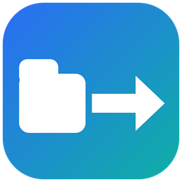

# WorkBuddy 数据目录迁移工具



一个把 WorkBuddy 数据目录 `%USERPROFILE%\.workbuddy` 从 C 盘安全搬到其他盘（含移动硬盘）的 Windows 图形化工具。
全中文界面，无需命令行，**破坏性操作全部可逆**。

<br clear="left">

---

## 它解决什么问题

WorkBuddy 会把日志、调用链、会话快照、内置工具链、插件、技能市场数据全部放进 `C:\Users\<用户名>\.workbuddy`。
这个目录只会越来越大，本机实测已经 **13.55 GB / 152,955 个文件 / 63 个一级子目录**。

C 盘吃紧时，手动方案通常只有三种，而且每种都容易出事：

| 手动做法 | 风险 |
| --- | --- |
| 剪切粘贴整个目录 | 中断即数据两空 |
| `mklink /J` 建联接 | 命令行为主，路径含空格/中文容易失败，建错不会自动还原 |
| 改环境变量 | 不知道产品读哪个变量，改了没生效也查不出原因 |

本工具把这三件事做成一个**带预检、带逐文件校验、带一键回滚**的图形化流程。

## 三种迁移方式

| 方式 | 做法 | 适用场景 |
| --- | --- | --- |
| **目录联接**（推荐） | 整个目录搬到新盘，原位置留 Junction | 对启动方式透明，不改任何配置，不需注销重登 |
| **环境变量** | 写入用户级 `WORKBUDDY_CONFIG_DIR` 并广播 `WM_SETTINGCHANGE` | 不想在原位置留联接；代价是需要注销重登 |
| **部分迁移** | 只搬大体积缓存类子目录，每个子目录单独建联接 | C 盘爆红但不敢动核心数据 |

## 迁移之后：归档与搬回

迁完之后还有两件事常需要做，工具都内置了（菜单「工具」）。

### 归档备份为压缩包

想释放源盘空间，又不想把唯一的退路直接删掉时用这个。选择保存路径 → 压缩 → **自动校验压缩包完整性** → 校验通过后才询问是否删除原备份。

- 优先调用 7-Zip（LZMA2，对日志/JSON 这类文本压缩率明显更好），未安装时回退到内置 Zip，零外部依赖
- 压缩包内保留顶层目录名，解压到原上级目录即可原样还原
- 拒绝把压缩包放进被压缩目录内部（否则会自己压自己）、拒绝覆盖已有压缩包
- 删除原备份时仍走「清理备份」的安全校验，不会误删非本工具生成的目录
- 文件数 153,072 / 14.6 GB 的实测压缩率见下（本机 7-Zip，`-mx5`）

### 搬回默认位置（撤销迁移）

把已经搬到别的盘的数据目录搬回 `%USERPROFILE%\.workbuddy`。核心是**「同盘中转 + 原子改名」**：

1. 复制到 `%USERPROFILE%\.workbuddy.restoring-<时间>`（与正式位置同卷）
2. 逐文件校验中转副本
3. 校验通过后才撤掉重定向（删联接 / 清环境变量）
4. 中转目录改名到正式位置 —— 同卷改名是原子操作，不存在「改了一半」

因此**前两步失败时现有配置完全没动过**；第 3、4 步失败会自动重建联接，退回搬回之前的状态。原盘那份数据全程不删，搬回后由你自己决定何时清掉。

预检会拦：数据来源是联接（多层重定向）、默认位置已是实体目录、位置互相包含、两处不在同一卷、空间不足、WorkBuddy 仍在运行。

## 安全设计

迁移顺序固定为五步，任何一步失败源数据都不会被删除：

1. **复制**到目标位置 —— 长路径安全，跳过重解析点
2. **逐文件校验** —— 逐个文件比对「存在 + 长度」，并核对文件数与总字节（合并模式改为逐文件确认）
3. **原目录改名** —— 改成 `.moved-<时间>`，**不删除**
4. **在原位置建立联接** —— 或写入环境变量
5. **写入回滚记录** —— JSON 清单，供一键还原

关键点在第 3 步：只有当第 1、2 步全部校验通过后才会执行；一旦第 4 步失败，工具会自动把 `.moved-*` 改回原名。第 5 步写入失败**不会**回滚已完成的迁移，只会明确告知「记录没写成」并把备份路径打到日志里——因为记账失败不等于数据搬坏了。

其它硬性保护：

- **源目录读不到就当场中止。** 读不了的目录里的文件既不会进清单也不会被复制，目标端同样看不到，只比总数会得到一次「假通过」。这类情况在写目标之前就被拦下，源数据零改动
- 目录联接通过 Win32 `FSCTL_SET_REPARSE_POINT` 直接创建，**不调用 `cmd.exe` / `mklink`**，创建后立即回读复核
- 移除联接前校验目标确实是联接，走 `RemoveDirectory`，**绝不递归删除**
- 全程使用 `\\?\` / `\\?\UNC\` 长路径，不依赖 `LongPathsEnabled` 注册表项（自检实测 468 字符）
- 全程跳过重解析点，避免重复复制与自引用死循环；被跳过的联接会连同路径一起列进日志
- 迁移前核对目标盘可用空间：数据量 + 64MB 余量
- 预检拦截：WorkBuddy 进程仍在运行、SQLite 文件被占用、源已是联接、目标与源互含、网络驱动器、目标非空、目标同名文件、环境变量冲突
- 回滚受阻时**如实报错**：原位置被别的东西占用、或备份已被清理，工具会保留记录并把退路留着，不会把记录标成「已回滚」

## 「只补不覆盖」合并模式

对标 `robocopy /XO`。默认拒绝写入非空目标；勾选后规则是：

| 目标文件状态 | 处理 |
| --- | --- |
| 目标更新 | 保留目标，绝不回退 |
| 内容相同且不旧 | 保留目标，不重写 |
| 目标缺失 | 补齐 |
| 目标更旧 | 用源覆盖（唯一允许覆盖的情形） |

该模式是幂等的——数据已就位后重复执行，结果为 0 个文件被复制。

## 部分迁移的分级表

分级依据只有一个：这份数据读不到时，用户要付出多大代价。

| 级别 | 含义 | 处理 |
| --- | --- | --- |
| 缓存 | 随时可重建 | 默认勾选 |
| 可重下 | 本机运行需要，可重新下载 | 默认勾选 |
| 有状态 | 含本地状态，盘位必须固定 | 默认不勾 |
| 核心 | 凭据、会话库、项目索引 | **禁止勾选** |
| 未识别 | 保守处理 | 默认不勾 |

分级表覆盖 100+ 个目录名，并对 GUID、`user-<guid>-personal`、`*-tmp` 三类命名做模式匹配。在本机 63 个真实一级子目录上实测：**未识别 0 个 / 0 B**。

界面提供四个预设按钮：`全选缓存`、`缓存+可重下（推荐）`、`仅选 ≥100MB`、`清空`。

## 使用步骤

1. 从托盘右键**完全退出** WorkBuddy，并在任务管理器中确认没有残留进程
2. 选择目标位置（下拉列表显示各盘可用空间与文件系统）
3. 选择迁移方式
4. 先点「仅预检」确认无阻断项，再点「开始迁移」
5. 启动 WorkBuddy 确认登录、会话、历史记录一切正常
6. 再点「清理备份」释放源盘空间（这一步才会真正删除，删除前会校验迁移仍然完好）
7. 出现任何异常，点「一键回滚」即可完整还原

## 内置环境自检

菜单「工具 → 运行环境自检」会在系统临时目录里开一个沙箱，跑 **17 组 / 166 项断言**：

| 用例 | 内容 |
| --- | --- |
| 0 | 联接重解析数据布局穷举（4 种布局 × 3 种句柄标志） |
| 1 | 目录联接 创建 / 读取 / 穿透读写 / 移除 |
| 2 | 非递归删除保护（真实目录与悬空联接） |
| 3 | 长路径复制 + 重解析点跳过（实测 468 字符） |
| 4 | 部分迁移端到端 + 回滚还原 |
| 4b | 清理备份 + 状态不一致时拒绝清理 |
| 4c | 整体迁移（联接方式）+ 预检拦截 + 回滚 |
| 4d | 环境变量方式端到端 + 还原 |
| 6 | 分级表断言 + 真实目录兜底扫描 |
| 7 | 合并到非空目标（含幂等性与 ScanPending 归零） |
| 8 | 扫描错误必须阻断（否则会静默漏拷却报校验通过） |
| 9 | 目标填盘根时的路径推导（防止拼成盘符相对路径） |
| 10 | 严格校验逐文件比对（总量相同也拦得住） |
| 11 | 回滚受阻时如实报错、记录不标已回滚 |
| 12 | 回滚记录写入失败时迁移成果必须保留 |
| 13 | 备份归档（压缩 → 校验 → 解压往返比对，含中文文件名） |
| 14 | 搬回默认位置（迁移 → 反向搬回 → 数据完整性） |

用例 8–12 是第二轮对抗性复查补上的：每一条都对应一个「能通过全部旧用例、但在真实环境里会出事」的缺口，且在修复前必然失败。用例 13、14 覆盖 v1.2 新增的归档与搬回。

自检**不读取、不修改真实数据目录**。

## v1.2 新增

| 功能 | 位置 | 说明 |
| --- | --- | --- |
| 归档备份为压缩包 | 工具 → 归档备份为压缩包… | 自选保存路径，7z 优先（标准压缩档），自动校验，校验通过才允许删原备份 |
| 搬回默认位置 | 工具 → 搬回默认位置（撤销迁移）… | 同盘中转 + 原子改名；失败自动重建联接 |

压缩级别默认 `-mx3`（较快）。十几万个小文件时 LZMA2 的开销主要在文件切换上，`-mx9` 相比 `-mx3` 只多压几个百分点，耗时却翻几倍。命令行可用 `--level N` 覆盖。

## v1.1 复查记录

第一轮自检 111 项全绿之后，又做了一轮「找能穿过全部旧用例的缺口」的对抗性复查，改掉 6 处：

| 问题 | 后果 | 修法 |
| --- | --- | --- |
| 扫描时读不到的目录只记进 `ErrorMessages`，没人看 | 那些文件既没复制也没进清单，目标端同样看不到，总数校验照样通过 → **静默漏拷**，而源目录已被改名 | 扫描后立刻 `ThrowIfScanFailed`，此时还没写目标、没动源，零风险中止 |
| 严格校验只比「文件数 + 总字节」 | 两个文件一长一短互相抵消，总量不变 → 漏判 | 逐文件比对存在性与长度，并核对目录集合 |
| 用户手动把目标填成 `D:\` 时，`Path.Combine("D:", ".workbuddy")` 得到的是**盘符相对路径** `D:.workbuddy` | `GetFullPath` 把它解析到 D 盘的「当前目录」，数据落到不可预期的位置 | 盘根补回分隔符，得到 `D:\.workbuddy`；并在预检里提示建议换用子目录 |
| 回滚时原名位置被占用/备份已缺失，只打一条警告就继续 | 记录被标成 `rolledback`，**退路就此作废**，再也没法通过工具还原 | `RollbackOne` 返回布尔值，任一环节没还原就抛错并保留记录 |
| 回滚记录写入失败被当成迁移失败，触发自动回滚 | 数据明明已经搬好，却因为记不了账而被整体退回 | 记账失败只告警，并把备份路径打到日志和结果对话框里 |
| 源目录内部已有的联接被跳过时不留痕迹 | 用户不知道新位置少了这些联接 | 日志逐条列出被跳过的路径，README 也写进已知限制 |

另外顺手修的小问题：`IsFileLocked` 改用 `FileAccess.Read` 申请独占（只读属性的文件不再被误判为「未占用」）；日志区每行 `new Font` 造成的 GDI 句柄泄漏；日志无上限增长；目标位置是「同名文件」时预检直接放行。

## 构建

需要 .NET 6 SDK（或更高版本 SDK + `net6.0-windows` 目标包）。

```bash
# 框架依赖版（约 1.4 MB，需 .NET 6 桌面运行时）
dotnet publish -c Release -r win-x64 --self-contained false \
  -p:PublishSingleFile=true -o dist

# 自包含版（约 61 MB，免安装）
dotnet publish -c Release -r win-x64 --self-contained true \
  -p:PublishSingleFile=true -p:IncludeNativeLibrariesForSelfExtract=true \
  -p:EnableCompressionInSingleFile=true -o dist-standalone
```

重新生成图标：

```bash
dotnet run --project tools/IconGen -c Release -- app.ico
```

## 命令行参数（仅排障用）

| 参数 | 作用 |
| --- | --- |
| `--selftest [日志路径]` | 跑完整自检并写日志，不开界面 |
| `--uicheck [报告路径]` | 真实布局窗口，输出控件边界溢出校验报告 |
| `--probe [报告路径]` | 只读统计真实数据目录的分级覆盖情况 |
| `--archive <源目录> <压缩包> [--verify-only]` | 归档备份目录并校验（供批处理 / 自动化验证） |

正常使用完全不需要这些参数。

## 已知限制

1. **迁移必须在 WorkBuddy 完全退出后进行。** 运行中数据目录里存在 SQLite WAL/SHM 活动，并发写会导致库损坏或复制到不一致快照。工具会检测并阻止，但不会替你关闭 WorkBuddy。
2. **目标盘符必须固定。** 目录联接与环境变量记录的都是绝对路径。移动硬盘盘符漂移会导致联接失效。
3. **不支持多台电脑共用同一数据目录。** 凭据由 OS 加密绑机、`device-id` 每机不同、数据库会并发写冲突。合并模式防的是同一台机器重复搬运导致的回退，防不了跨机冲突。
4. **源目录内部已有的联接不会被复制。** 它们指向的数据留在原处（原来的目录整体改名为 `.moved-*` 后仍在），但新位置不会重建这些联接。日志会列出具体路径。`.workbuddy` 正常情况下不含这类联接。
5. **不保留 NTFS ACL 与备用数据流（ADS）。** 复制走 `File.Copy`，目标文件继承目标目录的权限；文件的「来自 Internet」标记（`Zone.Identifier` 流）不会带过去。文件内容、长度、修改时间都保留，仅 `CreationTime` 不保留。
6. **写在盘根也能跑，但不推荐。** 目标位置手动填 `D:\` 时，数据会落在 `D:\.workbuddy`；更建议放在 `D:\WorkBuddyData` 这类专用子目录里，便于以后整体搬走。

## 许可

[MIT](LICENSE)
